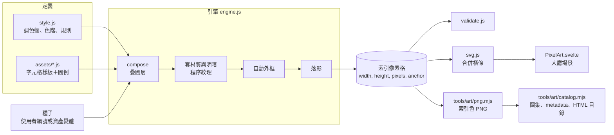

# 04 系統架構（提案）

日期：2026-11-17
狀態：提案。這裡的檔名與介面是設計，還沒有任何程式碼。

## 設計原則

- **一份引擎，三個使用者**：瀏覽器（大廳即時繪製角色）、Node 工具（匯出 PNG、目錄、驗證）、Vitest（測試）都呼叫同一份純 JavaScript 模組。
- **引擎不知道繪製方式**：輸出只是「帶索引的像素格」，不知道 SVG、PNG、Svelte 的存在。
- **模組少**：需求列了九個元件，對應到六個檔案（見下表），不為每個概念開一個類別。
- **不新增執行期依賴**：PNG 用 Node 內建的 `node:zlib` 寫入，不用 pngjs（pngjs 不支援寫入索引色 PNG，見來源）。

## 九個元件對應到檔案

| 需求的元件 | 檔案 | 執行環境 |
|---|---|---|
| 1 風格規格 | `web/src/art/style.js` | 瀏覽器、Node |
| 2 資產定義格式 | `web/src/art/assets/*.js`（每類一檔） | 瀏覽器、Node |
| 3 程序產生引擎 | `web/src/art/engine.js` | 瀏覽器、Node |
| 4 可組合圖層 | `web/src/art/engine.js` 內的 `compose()` | 同上 |
| 5 AI 產生介面（選用） | 第一版不做；預留 `tools/art/import-draft.mjs` 的位置 | 只在開發時 |
| 6 品質驗證 | `web/src/art/validate.js` | 瀏覽器、Node |
| 7 預覽與比對 | `tools/art/catalog.mjs`（產生靜態 HTML 目錄） | Node |
| 8 動畫與圖集匯出 | `tools/art/png.mjs`、`tools/art/catalog.mjs` | Node |
| 9 目錄與版本 | 資產定義裡的 `id`、`version`，加上 `tools/art/` 產出的 `catalog.json` | Node |

執行時（瀏覽器）只用到 `style.js`、`assets/`、`engine.js`，以及把像素格轉成 SVG 橫條的 `web/src/art/svg.js`（由現在 `sprite.js` 的 `toArt()` 搬過來）。

## 資料流



## 核心資料結構

### 索引像素格（引擎的唯一輸出）

```js
{
  width: 16,
  height: 24,
  pixels: Uint8Array,   // 長度 width*height；0 = 透明，其餘是調色盤索引
  anchor: { x: 8, y: 23 }, // 腳底中心，用來對齊座位與排序
}
```

### 風格規格 `style.js`

```js
export const STYLE_VERSION = 1;
export const PALETTE = ['#00000000', '#2b1a0e', ...]; // 索引 0 固定是透明
export const RAMPS = { wood: [i1, i2, i3, i4], skin1: [...], ... }; // 每條色階由暗到亮的調色盤索引
export const OUTLINE = 1;      // 調色盤索引
export const RULES = { tile: 16, maxColors: 48, maxHueStep: 20, ... };
```

### 資產定義（字元格樣板）

延續現在 `sprite.js` 的字元格寫法：人可以直接在編輯器裡看出形狀，diff 也看得懂。

```js
export const chair = {
  id: 'furniture/chair',
  version: 1,
  size: [12, 16],
  anchor: [6, 15],
  layers: [
    {
      name: 'back',
      depth: 'behind',          // behind = 角色之下；front = 角色之上
      rows: [
        '..1222221..',
        // …
      ],
      legend: { 1: ['wood', 0], 2: ['wood', 1], 3: ['wood', 2] }, // 字元 → [材質, 明暗階]
      texture: 'woodGrain',      // 選用：程序紋理規則
    },
  ],
  variants: { material: ['wood', 'darkWood'] }, // 選用：決定性變體
};
```

角色的定義多一層「部件」：身體、髮型、頭飾等各是一組圖層，`lookFor(userId)` 決定選哪些部件、哪條色階。

### 引擎 `engine.js` 的公開函式

```js
render(asset, { seed = 0, frame = 0, variant = {} } = {}) // → 索引像素格（或 { behind, front } 兩張）
renderCharacter(userId, { status, frame, pose })          // → 同上
```

內部步驟：疊圖層 → 把（材質, 階）換成調色盤索引 → 套程序紋理 → 自動外框 → 落影。全部是純函式，不碰 DOM、不讀檔。

### 驗證 `validate.js`

```js
validate(grid, asset) // → [{ rule: 'palette', level: 'error', message }, ...]，空陣列表示通過
```

檢查項目見 `06-acceptance-criteria.md`。

## 執行時整合（大廳）

這是整個計畫風險最高的部分。

```mermaid
flowchart TB
  subgraph 場景容器 .scene（整數倍縮放）
    L1[SVG：地板＋落影＋家具後半部]
    L2[HTML button.member × 16<br/>每個按鈕內有角色 SVG]
    L3[SVG：家具前半部<br/>pointer-events: none]
  end
  L1 --> L2 --> L3
```

- 場景改為**固定原生尺寸**（例：224×144 美術像素），桌面 3 倍、窄螢幕 2 倍，用 CSS 類別切換，不用 inline style。
  - 限制：目前版面最寬 1200px，場景欄約佔 1.6/2.6，扣掉邊距後約 690px 寬。3 倍時原生寬度不能超過約 230，所以 256 寬放不下。確切數字在第 1 階段排出 16 人後決定。
- 每個位子的錨點寫在 `web/src/lib/seats.js`（與位子編號放在一起）。按鈕的位置用 CSS 規則（每個 `data-seat` 一條），以 `calc(var(--px) * N)` 表示。一個測試檢查 CSS 裡的位置與 `seats.js` 的錨點一致。
- 角色仍然是 `<button class="member">`，保留 `aria-label`、`aria-pressed`、`data-seat`，現有測試不需要改斷言。
- 家具前半部畫在按鈕上方，設定 `pointer-events: none`，點擊仍然落到按鈕。
- 動畫：一個角色的所有幀都畫進同一個 SVG（每幀一個 `<g>`），由 `pixel.css` 的 `@keyframes` 加 `steps()` 切換顯示。全部在樣式表中，符合 CSP。`prefers-reduced-motion` 時停用。

### 為什麼執行時仍用 SVG，而不是 canvas 或 PNG

| 方式 | 結論 |
|---|---|
| SVG 橫條（現況） | 保留。CSP 沒問題、可以放進按鈕、測試在 jsdom 能檢查內容。 |
| canvas | 不採用。jsdom 沒有 canvas，元件測試會變難；無障礙要另外處理。 |
| 預先產生的 PNG | 只用在固定不變的家具時才可行，但角色做不到（建置時不知道有誰）。為了單一路徑，家具也用 SVG。 |

效能估計（推論，原型時量測）：一個 16×24 角色合併橫條後約 60–120 個 `<rect>`，16 人約 2000 個，加上場景家具，在一般桌機瀏覽器可以接受。驗收標準會設上限。

## 造型穩定性（重要）

- 現況：`lookFor(userId)` 依固定順序抽 6 次（髮型、頭飾、髮色、膚色、衣服、配件色）。
- 提案：**保留抽選順序與每項的選項數量**，只把每個選項換成新畫法。這樣同一個人換新畫法後仍是「同一種髮型、同一種髮色、同一件衣服顏色」，同事不會覺得自己被換掉。
- 若之後想增加選項，會讓大家的造型改變；那時要升 `LOOK_VERSION` 並在交接文件記錄。

## 開發工具（Node，不進入正式產物）

- `tools/art/png.mjs`：把索引像素格寫成索引色 PNG（color type 3，加 `tRNS` 透明），用 `node:zlib` 壓縮，自己實作 CRC32。約 60 行。
- `tools/art/catalog.mjs`：`npm run art:catalog`
  - 對每個資產與變體呼叫引擎、驗證、輸出原生大小 PNG。
  - 動畫輸出水平圖集 PNG 加 JSON（每幀的 x、y、w、h、時間、錨點）。
  - 產生 `catalog.json`：id、version、STYLE_VERSION、尺寸、用色數、像素內容的雜湊、驗證結果。
  - 產生 `index.html`：所有資產在 1×、2×、3× 與木地板、深色背景上的並排預覽，以及「目前版本 vs 上一版」的對照（上一版從 git 中的 `catalog.json` 雜湊判斷是否變更）。
  - 輸出目錄 `art-out/`，加入 `.gitignore`。
- 這個 HTML 是本機檔案，不經過伺服器，不受 CSP 影響；仍然不用外部資源。

## 版本與目錄

- 每個資產定義有 `version`；改了形狀就加一。
- `STYLE_VERSION` 在調色盤或規則改變時加一。
- 「黃金雜湊」測試：Vitest 對每個資產的像素格算雜湊，與存在 `web/src/art/golden.json` 的值比對。任何非預期的外觀改變都會讓測試失敗；刻意改外觀時要同時更新 `version` 與雜湊。

## AI 產生介面（選用，第一版不做）

只在開發時使用，流程如下：


- 金鑰只放在 git 忽略的本機設定檔，與 OpenProject token 同樣的規則。
- 產物一律先變成可讀的字元格樣板，執行時與 AI 無關。
- 是否要做、用哪個服務，是待決定事項。

## 不做的事

- 不做通用的資產編輯器（用文字編輯器改字元格即可）。
- 不支援 Aseprite 檔案匯入。
- 不做執行時的動態光影。

## 來源

- [pngjs（不支援寫入索引色）](https://github.com/pngjs/pngjs)
- [MDN：shape-rendering](https://developer.mozilla.org/en-US/docs/Web/SVG/Reference/Attribute/shape-rendering)
- [Universal LPC Spritesheet Character Generator（圖層加 z 值的概念）](https://github.com/LiberatedPixelCup/Universal-LPC-Spritesheet-Character-Generator)
