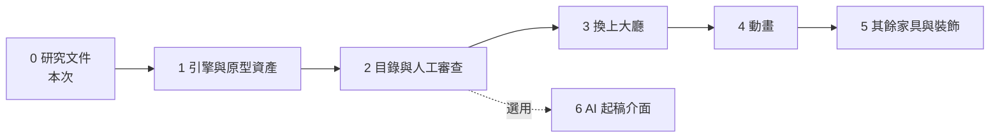

# 05 實作路線

日期：2026-11-17
狀態：提案。研究文件完成，**尚未開始實作**。

## 待決定事項（開工前需要使用者回覆）

| # | 問題 | 建議 | 影響 |
|---|---|---|---|
| 1 | 場景角色的原生尺寸 | 16×24，桌面 3 倍、窄螢幕 2 倍 | 決定場景大小與 16 人是否放得下 |
| 2 | 換畫法後造型是否要保持「同類型」 | 要：保留抽選順序與選項數量 | 若不要，可以自由重新設計選項，但所有人造型會變 |
| 3 | 光源方向 | 正上方偏左 | 所有資產的明暗 |
| 4 | 場景是否改為固定原生尺寸、整數倍縮放 | 是 | 寬螢幕兩側會留白，但像素一定銳利 |
| 5 | 是否加入待機動畫 | 是，2 幀，支援減少動態效果 | 每個角色的 `<rect>` 數量加倍 |
| 6 | AI 起稿介面 | 第一版不做 | 需要付費帳號、金鑰 |
| 7 | 調色盤上限 48 色、角色與家具共用部分色階 | 是 | 角色顏色多樣性 |

## 階段

每個階段結束時都能獨立驗收，正式功能在第 3 階段之前完全不變。

### 第 0 階段：研究與規格（本次）

- 產出 `docs/pixel-art/01`–`06`。
- 沒有程式變更。

### 第 1 階段：引擎與四個原型資產

目標：在 Node 與測試中產生四個資產，正式畫面不變。

- `web/src/art/style.js`：調色盤、色階、規則。測試：色階亮度單調、相鄰色相差 ≤ 20 度、最亮階飽和度低於中階、總色數 ≤ 48。
- `web/src/art/engine.js`：`compose`、材質、木紋、外框、落影、決定性變體。測試先寫（TDD）。
- `web/src/art/validate.js`：`06` 中可自動檢查的全部規則。
- `web/src/art/assets/`：人物（坐姿，沿用 6 個造型維度）、木椅、木桌、盆栽。
- `tools/art/png.mjs`：索引色 PNG 寫入，測試用 Node 讀回 PNG 標頭與 IDAT 解壓後比對像素。
- 黃金雜湊測試。

完成條件：`npm test` 全過；四個資產驗證零錯誤；同一個種子輸出位元組相同。

### 第 2 階段：目錄與人工審查

- `tools/art/catalog.mjs`、`npm run art:catalog`、`art-out/` 加入 `.gitignore`。
- 輸出：原生 PNG、圖集 PNG＋JSON、`catalog.json`、`index.html` 並排預覽。
- **人工審查點**：使用者看目錄頁，依 `06` 的人工清單打分。依意見修改樣板，直到使用者同意風格。這一步之後才動正式畫面。

### 第 3 階段：換上大廳

- `PixelArt.svelte` 改吃引擎輸出（經 `svg.js`）。
- `sprite.js` 的 `spriteFor` 改為呼叫引擎；`lookFor` 的抽選順序不變。
- 場景改為固定原生尺寸、三層（家具後半部、角色按鈕、家具前半部）。
- `seats.js` 增加錨點；CSS 與錨點一致性測試。
- 保持：按鈕結構、`aria-label`、`aria-pressed`、`data-seat`；所有既有測試不改斷言。
- 瀏覽器驗證：示例模式、真實 CSP、3 倍與 2 倍、16 人滿座、點選、鍵盤操作、CSP 違規為零。

### 第 4 階段：動畫

- 工作中、發呆 2 幀；休息靜止。
- CSS `@keyframes` + `steps()`；`prefers-reduced-motion` 停用。
- 驗證：動畫時每幀錨點不變、沒有 inline style。

### 第 5 階段：其餘家具與裝飾

- 吧檯、酒架與酒瓶、高腳椅、沙發、地毯、地板、牆、空位標示。
- 狀態圖示改用同一份調色盤。
- 依實際需要再加：植物變體、裝飾物。

### 第 6 階段（選用）：AI 起稿介面

- 只有在使用者決定要用、並自己準備好帳號與金鑰時才做。
- 只在開發時使用；產物轉成字元格樣板後進版本控制。

## 主要風險與對策

| 風險 | 對策 |
|---|---|
| 新畫法看起來不如預期 | 第 2 階段人工審查通過前不碰正式畫面 |
| 場景改版讓既有測試大量失效 | 保留按鈕結構與屬性，先跑既有測試再改畫面 |
| 16 人放不下 | 第 1 階段就用原型角色排出 16 人的場景尺寸試算 |
| `<rect>` 太多導致變慢 | 驗收設上限；必要時改成每人一個 `<path>` |
| 改動產生器讓大家換臉 | 保留抽選順序；黃金雜湊測試擋住非預期改變 |
| 規格數字是推估 | 所有數字集中在 `style.js`，原型後一次調整 |

## 工作量粗估（推論）

| 階段 | 估計 |
|---|---|
| 1 引擎與原型 | 1–2 個工作階段 |
| 2 目錄與審查 | 1 個工作階段＋使用者審查時間 |
| 3 換上大廳 | 1–2 個工作階段 |
| 4 動畫 | 半個工作階段 |
| 5 其餘家具 | 1–2 個工作階段，視審查回合數 |

美術品質主要取決於第 2 階段的回合數，這部分無法事先估準。
